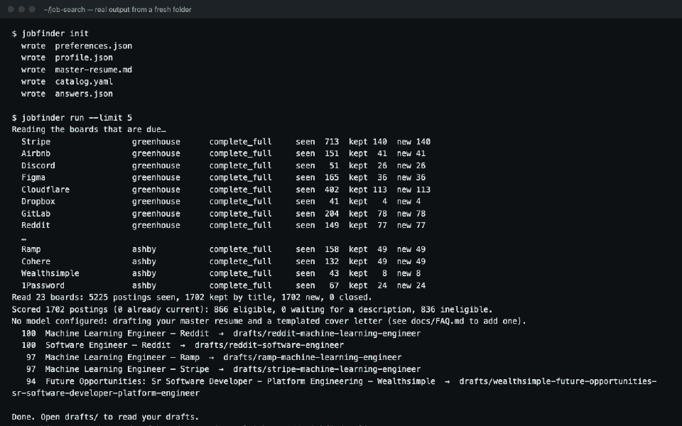
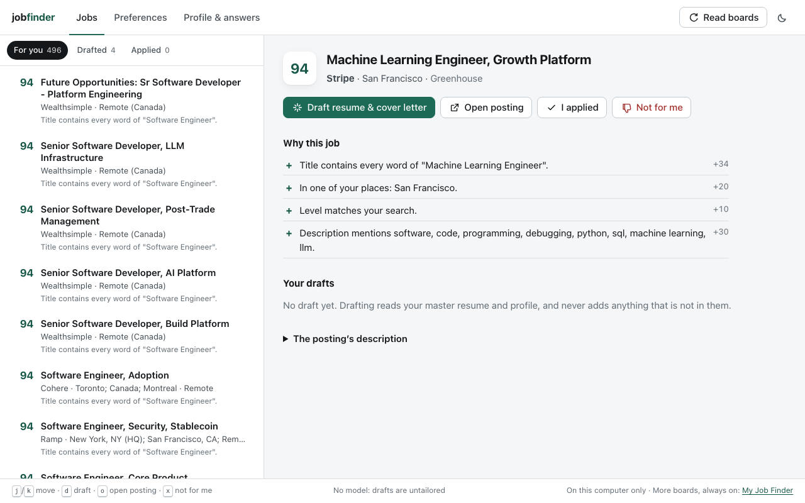
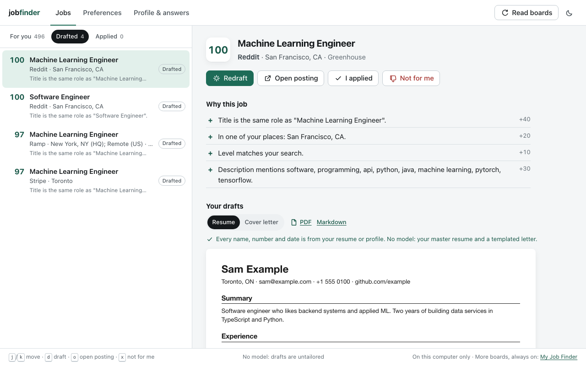
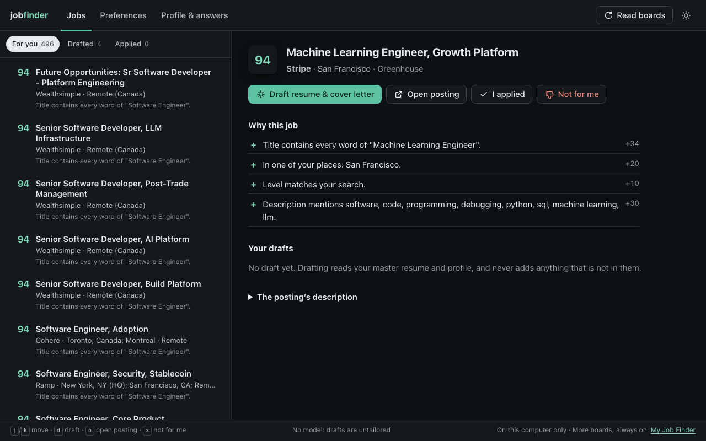
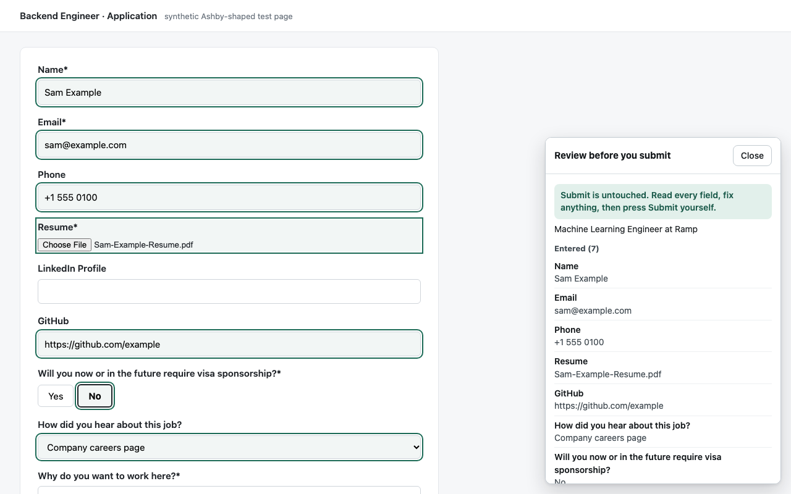
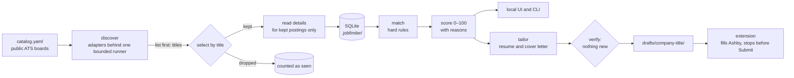

# my-job-finder-open-source

[](https://github.com/Jerrizzy001/my-job-finder-open-source/actions/workflows/ci.yml)
[](LICENSE)


A job finder that runs on your own computer. One command reads job postings straight from employers' public applicant-tracking boards (not aggregators), keeps the ones whose title means the work you want, checks them against your hard limits (place, work mode, co-op term), scores each one with reasons you can read, and drafts a tailored resume and cover letter for the best matches, locally, from your own resume. Nothing it drafts can contain a fact you did not write. A small local UI shows the matches and drafts, and a Chrome extension fills Ashby applications and then stops so you can review them and press Submit yourself.



## Want the whole thing?

This repository is the open core of **[My Job Finder](https://myjobfinder.live)**. The hosted product reads thousands of verified boards continuously, re-scores in the cloud so you don't have to run anything, tailors packages without you bringing a model key, and offers guided apply on Workday, Greenhouse, Lever, SmartRecruiters, Dayforce and more, with the same stop for your approval before anything is sent. It also has practice interviews, works across devices, and comes with support. If you would rather run it yourself, everything below is yours.

## Run it in 5 minutes

You need Node.js 22.18 or newer. No database server, no Docker, no account.

```bash
git clone https://github.com/Jerrizzy001/my-job-finder-open-source.git
cd my-job-finder-open-source
npm install
npm run build:web
npm link
```

`npm link` puts `jobfinder` on your path. Then, in a folder of its own:

```bash
mkdir ~/job-search && cd ~/job-search
jobfinder init
```

1. Edit `preferences.json`: the titles you want, your places, how you can work. `jobfinder init --student` starts from a co-op search instead.
2. Replace `profile.json` and `master-resume.md` with your own. The examples are a fictional person, Sam Example.
3. Run `jobfinder run`, then open `drafts/`.

```bash
jobfinder run      # discover → match → tailor; the one to put in cron
jobfinder serve    # the local UI on http://127.0.0.1:4321
```

The first run reads the 23 boards in `catalog.yaml` in about half a minute. Drafting uses no model until you configure one; with Ollama it is free and stays on your machine (see the [FAQ](docs/FAQ.md)). To run it every morning, see [docs/scheduling.md](docs/scheduling.md) for cron and launchd.

|                                                                     |                                                                                                               |
| ------------------------------------------------------------------- | ------------------------------------------------------------------------------------------------------------- |
|  |                                     |
|                               |  |

## How it works



| Package                                    | What it is                                                                                                                                                       |
| ------------------------------------------ | ---------------------------------------------------------------------------------------------------------------------------------------------------------------- |
| [`packages/core`](packages/core)           | The matching engine: title families, student markers, hard rules, scores and reasons. Pure TypeScript, no I/O.                                                   |
| [`packages/sources`](packages/sources)     | Nine discovery adapters (Greenhouse, Lever, Ashby, SmartRecruiters, Workable, iCIMS, Workday, Dayforce, JSON-LD career pages) behind one polite, bounded runner. |
| [`packages/tailor`](packages/tailor)       | Local drafting: an OpenAI-compatible client, the no-invention verifier, and a built-in PDF writer.                                                               |
| [`packages/server`](packages/server)       | SQLite (Node's built-in `node:sqlite`), the scheduler, and the 127.0.0.1-only API.                                                                               |
| [`packages/web`](packages/web)             | The local UI: Jobs, Preferences, Profile & answers. Vite and React.                                                                                              |
| [`packages/extension`](packages/extension) | Chrome MV3, loaded unpacked. Ashby only, review before submit.                                                                                                   |
| [`packages/cli`](packages/cli)             | `jobfinder init · discover · match · tailor · run · serve · boards · export`.                                                                                    |

[docs/architecture.md](docs/architecture.md) walks the pipeline and records the main design decisions as short ADRs.

## How matching works

A title is read for the **kind of work** it names, not compared as a string. Student markers (intern, co-op, work term, PEY, placement, "Summer Student", a leading or trailing "Student") are all one level, and a student search never matches a non-student title. Six real titles against the search `AI engineer intern, Software developer intern`:

| Posting title                               | Tier      | Why                                                                                     |
| ------------------------------------------- | --------- | --------------------------------------------------------------------------------------- |
| Software Developer, Work Term               | `exact`   | "Work Term" is the same level as "intern"; the rest is the same words.                  |
| AI Solutions Engineer Intern                | `close`   | Every word of "AI engineer intern" is in it.                                            |
| Applied AI Program Design & Delivery Intern | `family`  | No shared role words, but "Applied AI" is AI and machine learning work.                 |
| Technology Analyst Intern                   | `related` | Technical-sounding but in no family: kept until its description is read, which decides. |
| AI Sales Intern                             | `none`    | "AI" is in the title, but the work is sales.                                            |
| Student Success Manager                     | `none`    | A job _about_ students, not one _for_ a student.                                        |

Then come the hard rules (the role, your places and remote regions, work mode, blocked companies and words, and a co-op term that must end before your graduation) and a score out of 100 from title, place, level and description evidence, capped while there is no description. Every score ships with its reasons; the UI shows them under "Why this job". On a hand-labelled set of 97 titles, title selection reaches 94% precision and 92% recall; `npm run bench` prints the numbers and every miss.

## Ethics

These are enforced in code, not only promised here ([docs/ethics.md](docs/ethics.md)):

- **Polite reads.** An honest User-Agent with a contact URL, at least one second between requests to a host, robots.txt fetched and honoured, backoff on 429 and 503, no retry loops, and a request and byte budget per board.
- **Public data only.** Keyless public endpoints and pages; nothing behind a login, no private APIs.
- **You submit.** The extension fills what it can and stops. It never presses Submit, never touches a CAPTCHA, never creates accounts, never disguises itself, and never makes up an answer: an unknown question is left for you.
- **Your data stays here.** Profile, resume, answers and history live in a local SQLite file. No telemetry; nothing phones home.
- **Nothing invented.** Drafts may select, reorder and rephrase your own resume. A verifier checks every name, number and date against your sources and discards a draft that adds one.

## Roadmap

See [docs/roadmap.md](docs/roadmap.md).

## Contributing

Pull requests are welcome. [CONTRIBUTING.md](CONTRIBUTING.md) shows how to add an adapter in 30 minutes. `npm test` runs the whole suite and `npm run leak-check` must pass. Please read the [code of conduct](CODE_OF_CONDUCT.md), and report security issues the way [SECURITY.md](SECURITY.md) asks.

## Want the whole thing?

A job search on your laptop works well for a few dozen boards. Finding and verifying thousands of employers' boards and keeping them fresh is what the hosted product does. **[My Job Finder](https://myjobfinder.live)** adds that, plus cloud discovery and re-scoring, tailoring without your own key, guided apply on more systems (still stopping for your approval), interview practice, and support.

## License

Apache-2.0. See [LICENSE](LICENSE) and [NOTICE](NOTICE).
