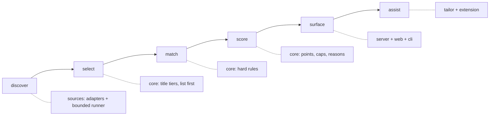
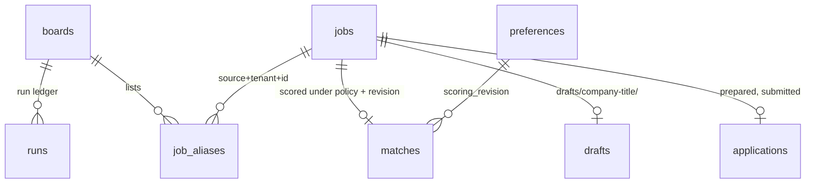

# Architecture

The whole system is one pipeline. Each stage is one package, and each package can be read on its own.

| Stage        | Where                                             | In one line                                                                                      |
| ------------ | ------------------------------------------------- | ------------------------------------------------------------------------------------------------ |
| **Discover** | `packages/sources`                                | Read public ATS boards through adapters; the runner owns politeness and limits.                  |
| **Select**   | `packages/core/src/titles.ts`                     | Keep a listing when its title reaches a tier above `none`; count the rest as seen and drop them. |
| **Match**    | `packages/core/src/rules.ts`                      | Hard rules: role, place, remote region, work mode, blocks, co-op term vs graduation.             |
| **Score**    | `packages/core/src/score.ts`                      | 0–100 from title, place, level and description evidence, with ceilings, penalties and reasons.   |
| **Surface**  | `packages/server`, `packages/web`, `packages/cli` | Store in SQLite, list current matches only, show "Why this job".                                 |
| **Assist**   | `packages/tailor`, `packages/extension`           | Draft from your own resume, verify nothing is new, fill Ashby and stop before Submit.            |

## Data

One SQLite file, `.jobfinder/jobfinder.sqlite`, through Node's built-in `node:sqlite`. Forward-only migrations live in `packages/server/src/db.ts`.

Your plain files are the source of truth for what you edit (`preferences.json`, `profile.json`, `master-resume.md`, `catalog.yaml`); the database mirrors preferences to know when they changed, and holds everything derived.

## The bounded runner

`packages/sources/src/runner.ts` and `http.ts`. An adapter only builds requests and parses answers; it never calls `fetch` itself. Every request goes through `BoundedHttp`, which:

- sends `jobfinder-oss/<version> (+repo URL)` as the User-Agent;
- allows https only, and only the hosts the adapter declares for that board;
- fetches robots.txt once per host and refuses disallowed paths (a 4xx robots.txt means no rules; a 5xx or unreachable one means disallow everything);
- waits at least a second between requests to a host, across boards;
- stops on 429 or 503 and backs the host off (Retry-After, or ten minutes);
- caps requests per run, bytes per response and bytes per run, and follows at most three redirects, each to an allowed host.

## Design decisions

### ADR 1: Title families, not string equality

**Context.** Word matching fails both ways. "Applied AI Program Design & Delivery Intern" shares no role word with "AI engineer intern" and is the same work; "AI Sales Intern" shares two words and is not. Student postings say the same level in a dozen ways.

**Decision.** Read every title for its _family_ first, with an ordered list of recognisers: non-technical work written with a technical word ("AI Sales", "Technical Support") wins over technical role words, which win over other work, which win over weak words ("AI", "Data"). Tiers run `exact → close → family → related → none`, and student markers normalise to one level before any comparison.

**Consequences.** The taxonomy is small and readable (`families.ts`) and can be wrong in ways a reader can see and fix. A 72-row acceptance table pins its behaviour, and `npm run bench` measures it against hand labels.

### ADR 2: Human in the loop for applying

**Context.** Automated submission is where job tools do harm: wrong answers sent in your name, CAPTCHAs bypassed, accounts created, sites treated as adversaries.

**Decision.** The open-source extension fills, highlights and lists, then stops. It never presses Submit, never interacts with a CAPTCHA, never signs in or creates an account, and leaves any question without a known answer empty. These are tested in `packages/extension/test` (no `submit()`, no Enter key, requests only to 127.0.0.1).

**Consequences.** You do the last click on every application. That is slower than a bot and it is the point.

### ADR 3: List first, details only for what you would keep

**Context.** Some boards (SmartRecruiters, iCIMS, Workday) list titles without descriptions, and reading every detail page is slow and impolite: a large employer lists thousands of postings.

**Decision.** Select by title from the list, then read details only for the selected postings, inside the same request budget. For such boards at most half the budget goes to listing, so the rest is left for details. Unselected listings are counted as seen and not stored. A `related` title waits for its description, which decides it.

**Consequences.** A run reads a large board in a few dozen requests. A posting whose title is wrong for you is never read in detail, so a very unusual title for the right work can be missed; the bench reports how often.

### ADR 4: Policy versions

**Context.** Scores are stored. When a rule changes, old scores silently become wrong.

**Decision.** `MATCHING_POLICY_VERSION` is stored with every match, along with the preferences revision. A match under an older policy or older preferences is stale: listing never shows it as ready, and the next match run re-scores it. `policy.test.ts` pins a hash of the rule files, so changing a rule without bumping the version fails CI.

**Consequences.** One extra line in every rule change, and no stale scores in the UI.

### ADR 5: No native dependencies, no build step for the CLI

**Decision.** The CLI and server run TypeScript directly with Node's type stripping, and use `node:sqlite`. PDFs come from a small built-in writer using the standard PDF fonts. `npm install` compiles nothing.

**Consequences.** Node 22.18 or newer is required, and `node:sqlite` prints an experimental warning that the CLI hides.
